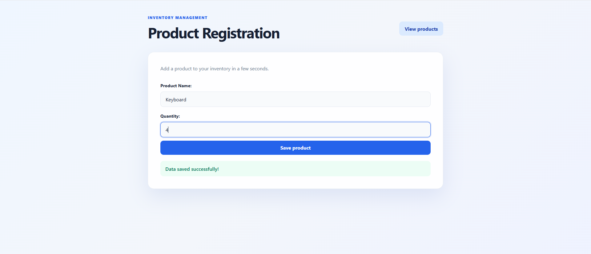
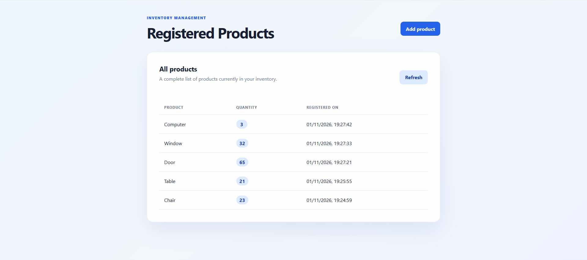

## License

This project is licensed under the [MIT License](LICENSE).

# Full stack web application with Flask and SQLite

This project is a full stack web application that uses Flask on the backend with a SQLite database and a static frontend built with HTML, CSS, and JavaScript. The backend exposes a RESTful API that is consumed by the frontend to interact with the database data.

## Previews





## Description

The application was created to demonstrate how to build a backend server with Flask, connect to a SQLite database, and integrate it with a static frontend. Communication between the frontend and backend happens through an API, which can be accessed from a browser or other client applications.

## Technologies Used

- **Backend**: Flask (Python)
- **Database**: SQLite
- **Frontend**: HTML, CSS, JavaScript
- **Local Server**: To run the frontend locally and consume the API

## How to Run the Project Locally

### 1. Clone the Repository

```bash
git clone https://github.com/BernardoAlvesdeOliveira/app-web-full-stack.git
cd app-web-full-stack
```

### 2. Install Backend Dependencies

First, install the Python dependencies:

```bash
pip install -r backend/requirements.txt
```

### 3. Configure the SQLite Database

No separate database server is required. The application creates the `database/stock.db` file and the required table automatically when the backend starts receiving requests.

### 4. Run the Backend Server (Flask API)

To start the backend and frontend together, execute this command in the project root:

```powershell
.\start.ps1
```

The script installs the backend dependencies, starts the API on port `5001`, starts the frontend on port `8000`, and opens the frontend in the browser. The SQLite database file is created automatically in `database/stock.db`.

### 5. Run the Frontend Locally

The frontend is started automatically by `start.ps1` on port `8000`.

### 6. Test the Application

Now you can access the frontend at `http://localhost:8000` and test its integration with the backend running at `http://localhost:5001`.

## Features

- **RESTful API**: The backend provides endpoints to interact with the database.
- **Frontend**: The frontend consumes the API to display and manipulate data.
